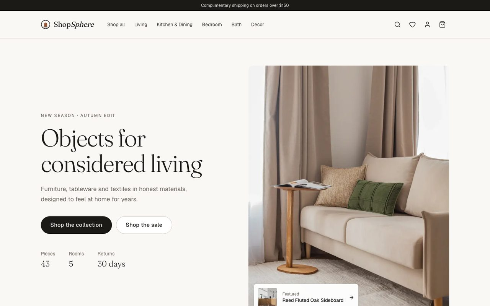
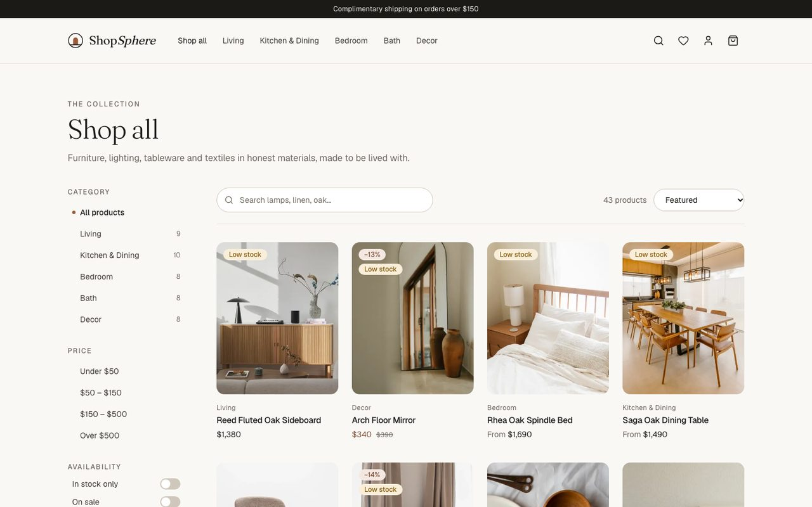
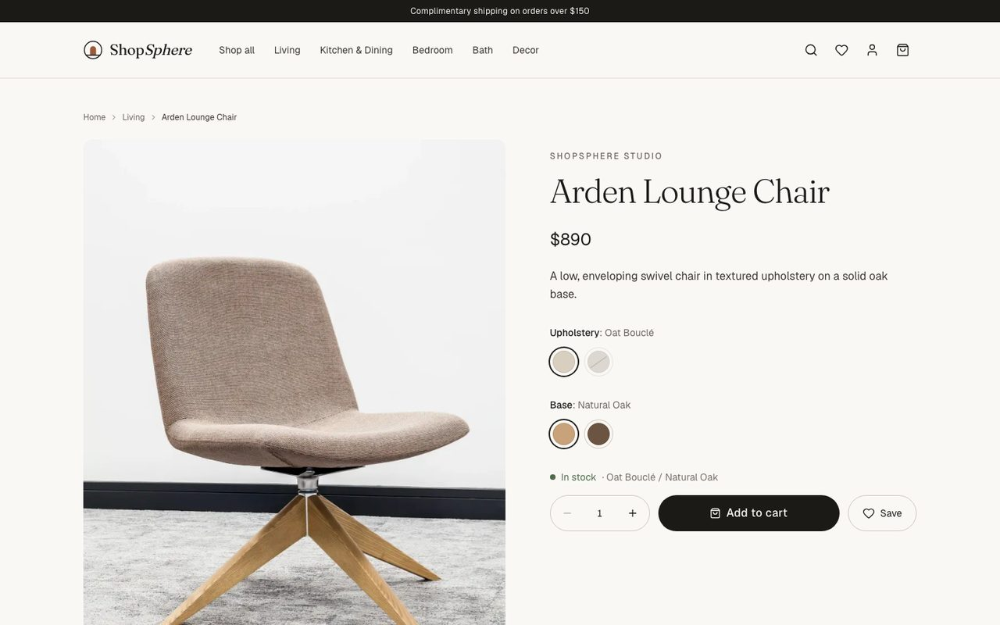
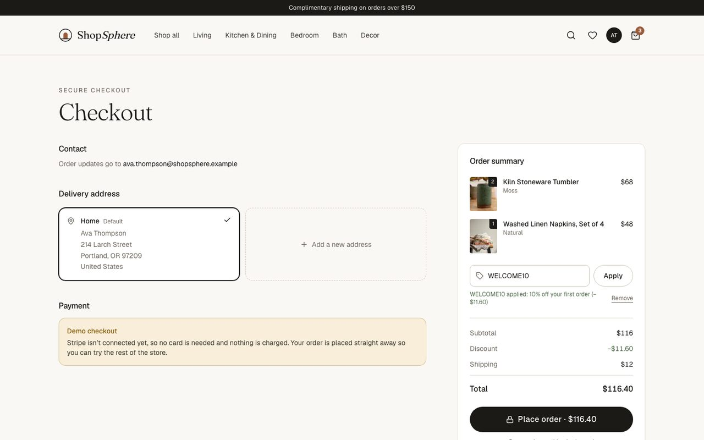
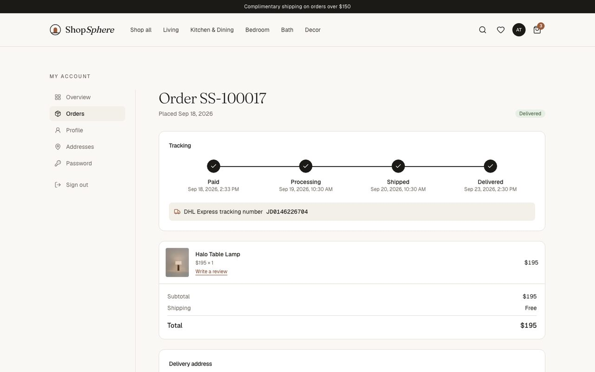
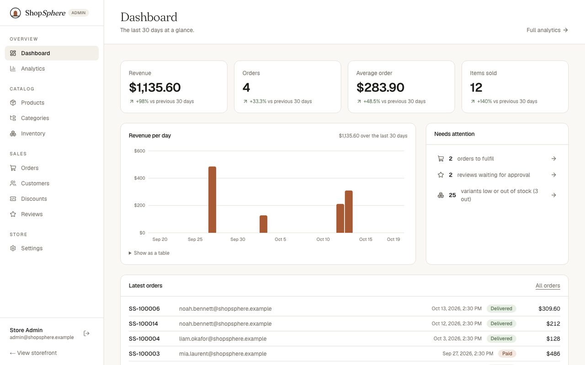
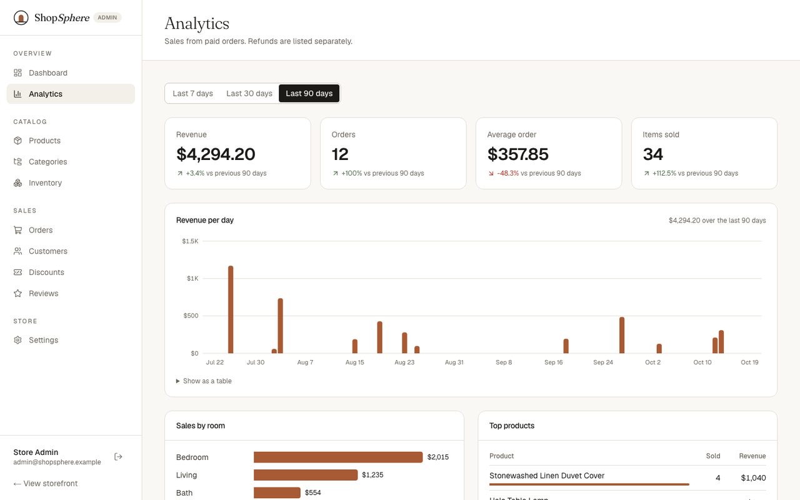
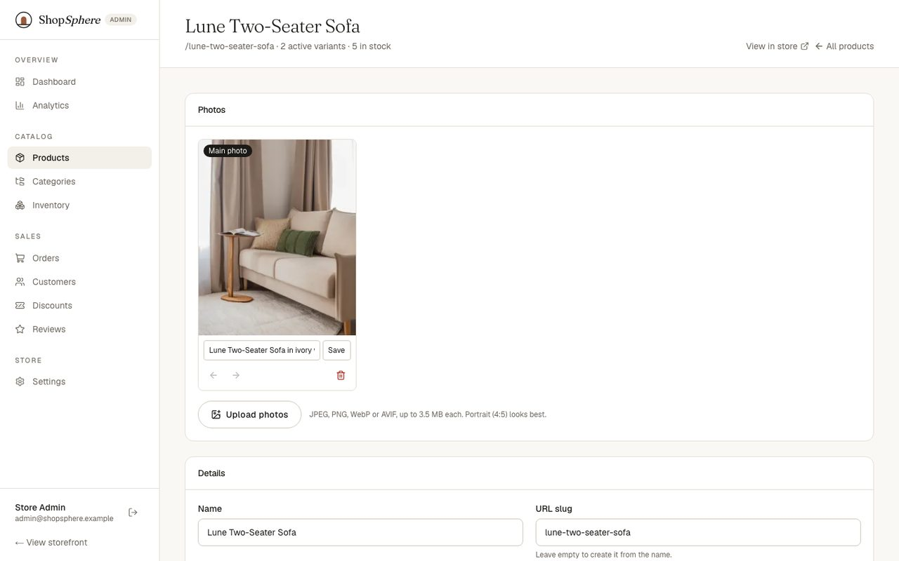
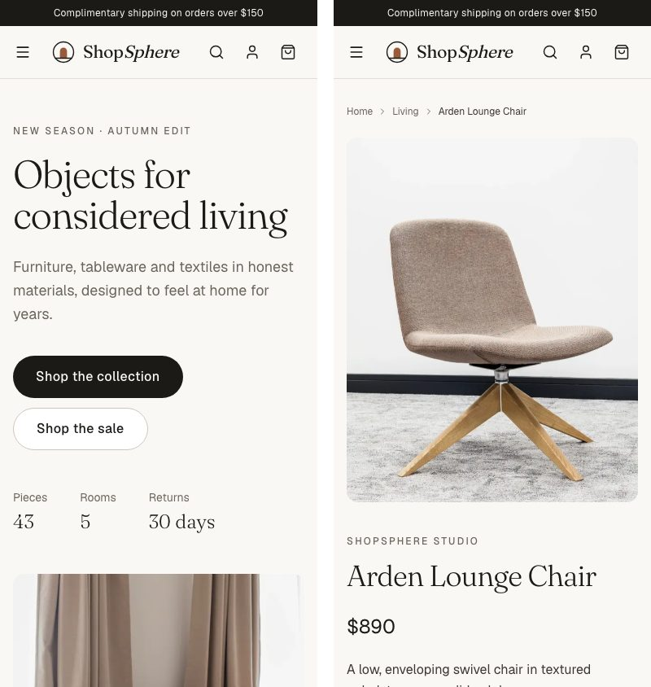

# ShopSphere

A full-stack e-commerce store for modern home and lifestyle goods: a premium storefront, real checkout, order tracking, and a complete admin area with analytics. Built with Next.js 16, Supabase and Stripe.

**Live demo:** https://shopsphere-azure-one.vercel.app

> Payments run in **Stripe test mode only**. No real charges are ever made. Until a Stripe test key is configured, checkout runs in a clearly labelled demo mode that places orders without taking payment.



## What it does

**Storefront**

- Catalog of 43 products across 5 rooms, with search (full-text plus partial words), filters by room, price, availability and sale, five sort orders and pagination, all kept in the URL so results can be shared
- Product pages with a gallery, colour/size/material pickers that grey out sold-out or nonexistent combinations, live price and stock per variant, specifications, reviews and related products
- Cart for guests and signed-in shoppers; a guest's cart moves into their account when they sign in
- Wishlist, customer accounts, address book, order history with a tracking timeline, and reviews marked "verified purchase" only for real buyers

**Checkout**

- Stripe Hosted Checkout (test mode) with shipping, tax and discount codes
- Stock is reserved atomically when checkout starts, so two people can never buy the last unit; abandoned checkouts give their stock back
- Signature-verified, idempotent Stripe webhook, plus a success page that confirms the payment with Stripe directly

**Admin**

- Dashboard and analytics: revenue, orders, average order value and items sold against the previous period, revenue per day, sales by room and top products
- Products with options and per-variant price, SKU, stock and photos (uploads to Supabase Storage), categories and inventory with an audit log
- Orders: fulfilment (processing → shipped with tracking → delivered) and refunds; customers; discount codes; review moderation; store settings that the storefront reads live

| Shop                                                            | Product                                                            |
| --------------------------------------------------------------- | ------------------------------------------------------------------ |
|                  |  |
| **Checkout**                                                    | **Order tracking**                                                 |
|  |           |
| **Admin dashboard**                                             | **Analytics**                                                      |
|               |                  |
| **Product editor**                                              | **Mobile**                                                         |
|             |       |

## How it's built

| Layer      | Technology                                                              |
| ---------- | ----------------------------------------------------------------------- |
| Framework  | Next.js 16 (App Router, Cache Components, Server Actions), React 19     |
| Language   | TypeScript (strict)                                                     |
| Styling    | Tailwind CSS v4 with custom design tokens; Fraunces and Geist typefaces |
| Database   | Supabase Postgres with Row-Level Security on every table                |
| Auth       | Supabase Auth with cookie sessions (`@supabase/ssr`)                    |
| Files      | Supabase Storage                                                        |
| Payments   | Stripe Checkout and webhooks (test mode)                                |
| Validation | Zod                                                                     |
| Testing    | Vitest, Testing Library, PGlite (Postgres in memory), axe-core          |
| Hosting    | Vercel, with GitHub Actions running every check on each pull request    |

### Engineering highlights

- **Security in layers.** A route proxy, server-side role checks in every page and Server Action (a test fails the build if an admin page forgets one), and Postgres Row-Level Security as the final guard. Production pages send a Content Security Policy and HSTS.
- **Money is computed only on the server**, in integer cents, from database prices. The browser sends a variant id and a quantity, never a price.
- **Database functions do the critical work atomically:** `reserve_order` (stock and price re-checked in one transaction), `mark_order_paid` (idempotent), `release_order` and `refund_order`.
- **Fast pages:** public catalog data is cached with Next.js `"use cache"` and refreshed instantly by admin edits (`updateTag`); per-shopper parts (cart count, wishlist, account) stream in separately.
- **Accessible:** axe-core reports no WCAG 2.1 AA violations on 31 store, account and admin pages; every chart has a keyboard-accessible tooltip and a table view.

More detail: [docs/ARCHITECTURE.md](docs/ARCHITECTURE.md) · [docs/DATABASE.md](docs/DATABASE.md)

## Running it locally

**Prerequisites:** Node.js 24+, a free [Supabase](https://supabase.com) project, and optionally a free [Stripe](https://stripe.com) account (test mode).

```bash
npm install
cp .env.example .env.local     # fill in your values
npm run dev                    # http://localhost:3000
```

### Setting up the database

```bash
npm run db:link                          # once
npx supabase db push --include-seed      # schema + catalog
npm run db:seed:images                   # product photos
npm run db:seed:demo                     # demo admin, customers, orders and reviews
```

The demo script creates `SEED_ADMIN_EMAIL` as the admin and four customers (`ava.thompson@shopsphere.example`, `noah.bennett@…`, `mia.laurent@…`, `liam.okafor@…`) using the passwords in `.env.local`. Every seed step is safe to re-run.

### Connecting Stripe (optional)

1. Copy your **test** secret key (`sk_test_…`) into `STRIPE_SECRET_KEY`. Live keys are rejected.
2. For local webhooks, run `stripe listen --forward-to localhost:3000/api/stripe/webhook` and put the printed `whsec_…` into `STRIPE_WEBHOOK_SECRET`. In production, add an endpoint for `/api/stripe/webhook` with the `checkout.session.*` events.
3. Pay with test card `4242 4242 4242 4242`, any future date and any CVC.

Without a key, checkout runs in demo mode. Without a webhook, orders are still confirmed when the shopper returns from Stripe.

### Environment variables

All variables are documented in [`.env.example`](.env.example).

| Variable                                                        | Where it's used   | Secret?                       |
| --------------------------------------------------------------- | ----------------- | ----------------------------- |
| `NEXT_PUBLIC_SITE_URL`                                          | Browser + server  | No                            |
| `NEXT_PUBLIC_SUPABASE_URL`                                      | Browser + server  | No                            |
| `NEXT_PUBLIC_SUPABASE_PUBLISHABLE_KEY`                          | Browser + server  | No (protected by RLS)         |
| `SUPABASE_SECRET_KEY`                                           | Server only       | **Yes**                       |
| `SUPABASE_DB_PASSWORD`                                          | Supabase CLI only | **Yes**                       |
| `GMAIL_ADDRESS`, `GMAIL_APP_PASSWORD`                           | Supabase CLI only | **Yes** (app password)        |
| `SEED_ADMIN_EMAIL`, `SEED_ADMIN_PASSWORD`, `SEED_DEMO_PASSWORD` | Seed scripts only | **Yes** (passwords)           |
| `STRIPE_SECRET_KEY`                                             | Server only       | **Yes** (must be `sk_test_…`) |
| `STRIPE_WEBHOOK_SECRET`                                         | Server only       | **Yes**                       |

Secrets are validated at runtime and imported only from `server-only` modules, so the build fails if one is ever pulled into browser code.

## Scripts

| Command                    | What it does                                      |
| -------------------------- | ------------------------------------------------- |
| `npm run dev`              | Start the development server                      |
| `npm run build`            | Production build                                  |
| `npm run lint`             | ESLint                                            |
| `npm run typecheck`        | Generate route types and run the TypeScript check |
| `npm test`                 | Unit, component and database tests                |
| `npm run verify`           | lint + typecheck + test + build (same as CI)      |
| `npm run db:push`          | Apply migrations to the linked Supabase project   |
| `npm run db:types`         | Generate TypeScript types from the database       |
| `npm run db:seed:generate` | Rebuild `supabase/seed.sql` from the catalog      |
| `npm run db:seed:images`   | Upload catalog photos to Supabase Storage         |
| `npm run db:seed:demo`     | Create demo accounts, orders, reviews and carts   |

## Tests

`npm test` runs 175 tests: pricing, filters, variant selection, the guest cart cookie, form validation, components, and a database suite that loads every migration into an in-memory Postgres and checks what visitors, customers and admins can and can't do, including stock reservation, payments and refunds.

## Project structure

```
src/
  app/
    (store)/          Storefront: home, catalog, product, cart, checkout, account, help
    (auth)/           Sign in, register, password reset
    admin/            Admin: dashboard, analytics, products, orders, customers…
    api/stripe/       Stripe webhook
  features/           Feature modules (catalog, cart, checkout, orders, reviews, admin…)
  components/         Design-system primitives, layout and admin shell
  lib/                Env validation, Supabase and Stripe clients, pricing, auth
  proxy.ts            Session refresh and route protection
supabase/
  migrations/         Schema, triggers, RLS, storage, checkout and refund functions
  seed/catalog.ts     The catalog: single source of truth for seed data
tests/                Database and admin-authorization tests
docs/                 Architecture, database, image credits, screenshots
```

## Roadmap

- [x] **Phase 1:** Project setup, architecture, design system, database schema
- [x] **Phase 2:** Supabase project, migrations, seed data and product imagery
- [x] **Phase 3:** Authentication, customer profiles, addresses, admin authorization
- [x] **Phase 4:** Storefront catalog: home page, listing, search, filters, product pages
- [x] **Phase 5:** Cart (guest and signed-in, merged on sign-in) and wishlist
- [x] **Phase 6:** Checkout with Stripe, webhooks, stock reservation, discount codes
- [x] **Phase 7:** Order history and tracking, ratings and reviews
- [x] **Phase 8:** Admin: products and variants, categories, inventory
- [x] **Phase 9:** Admin: orders, customers, discounts, review moderation, settings
- [x] **Phase 10:** Sales analytics dashboard
- [x] **Phase 11:** Security headers, accessibility audit, help pages, sitemap
- [x] **Phase 12:** Production deployment on Vercel

Next ideas: transactional emails through a custom domain, CAPTCHA on sign-up, and Playwright end-to-end tests in CI.

## License

Source code © 2026 Rawdha Hasan. **All rights reserved**: the code is public to view as a portfolio, but it may not be copied or reused without written permission (see [LICENSE](LICENSE)). Product photography is from Unsplash, used under the Unsplash License; photographers are credited in [docs/IMAGE_CREDITS.md](docs/IMAGE_CREDITS.md). Product names, descriptions and prices are invented.
